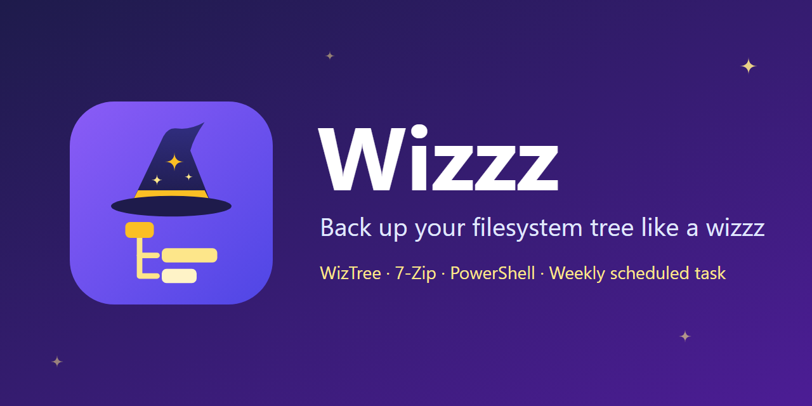

<p align="center">
  
</p>
<p align="center">
  <a href="LICENSE">
    
  </a>
</p>

## Backup filesystem tree like a wizzz
> This script makes a copy of filesystem tree using WizTree and exports each drive tree to CSV,
> then compresses the files in a single archive
> and copies the backup to multiple locations

## Requirements
* Windows with PowerShell 5.1 or PowerShell 7
* [WizTree](https://diskanalyzer.com/download) installed
* [7-Zip](https://www.7-zip.org/) (optional but recommended). Used when installed, archives are about half the size of a Zip.
* Administrator privileges. The script restarts itself as administrator if needed.

The script finds WizTree in its own folder or in the WizTree installation folder.
Use `-WizTreePath` if WizTree is installed somewhere else.

## Install
Run `.\Wizzz_backup.ps1 -Configure` and save to set up the settings and install Wizzz,
or install it directly with `-InstallTask`.
This copies the script and its configuration to `C:\Program Files\Wizzz`
and creates a scheduled task that runs this copy every Sunday at 23:12,
so the folder you downloaded Wizzz to can be deleted.
If the computer is off at that time, the backup runs as soon as possible afterwards.
The task runs whether you are logged on or not.

```powershell
.\Wizzz_backup.ps1 -InstallTask
```

The task uses the [configuration](#configuration) and the other [options](#usage) given with `-InstallTask`:

```powershell
# Every Friday at 02:00, without scanning E: and with a copy in Google Drive
.\Wizzz_backup.ps1 -InstallTask -TaskDay Friday -TaskTime 02:00 -SkipScan "E:" -CopyTo "G:\My Drive\Backup"
```

| Option | Description |
| --- | --- |
| `-InstallTask` | Install Wizzz and register the scheduled task, then exit. Running it again updates the installed copy and the task. |
| `-UninstallTask` | Remove the scheduled task and the installed copy, then exit. The backups and logs are kept. |
| `-InstallPath <path>` | Folder where Wizzz is installed (default: `C:\Program Files\Wizzz`) |
| `-TaskDay <day>` | Day of the week the task runs (default: `Sunday`) |
| `-TaskTime <time>` | Time the task runs (default: `23:12`) |

To change the settings later, run `-Configure` from the installed copy,
or from the downloaded folder: saving then offers to update the installed copy.

```powershell
& "C:\Program Files\Wizzz\Wizzz_backup.ps1" -Configure
```

## Uninstall

```powershell
.\Wizzz_backup.ps1 -UninstallTask
```

## Usage
This will run the script and make a backup.

```powershell
.\Wizzz_backup.ps1 -Silent
```

| Option | Description |
| --- | --- |
| `-Silent` | Accept all prompts automatically |
| `-NoCopy` | Do not copy the backup to the other drives (`-CopyTo` folders are still used) |
| `-ForceZip` | Use the built-in Zip compression even if 7-Zip is installed |
| `-BackupRoot <path>` | Full path of the folder where the backup is saved (default: `C:\Backup`) |
| `-WizTreePath <path>` | Full path of `WizTree.exe` |
| `-SkipScan <drives>` | Drives that are not exported, e.g. `-SkipScan "E:","F:"` |
| `-SkipCopy <drives>` | Drives the backup is not copied to, e.g. `-SkipCopy "D:"` |
| `-CopyTo <folders>` | Extra folders the backup is copied to, e.g. `-CopyTo "G:\My Drive\Backup"` |

Lists can also be written as a single comma separated value, e.g. `-SkipScan "E:,F:"`.

Each local fixed drive is exported to a CSV file and all the files are compressed into
`Backup_<date>_<time>.7z` (or `.zip`) in the backup folder.
The archive is then copied to the same folder on every other local fixed drive.
Virtual drives that are not on a disk partition, such as the Google Drive drive, are skipped.

`-CopyTo` adds folders to these automatic copies, they are not replaced.
`-CopyTo` folders are always used, even on drives that are normally skipped,
so it can be used to keep a copy in Google Drive or on a removable drive:

```powershell
# Copy to the other drives except D:, and to Google Drive
.\Wizzz_backup.ps1 -SkipCopy "D:" -CopyTo "G:\My Drive\Backup"

# Only copy to Google Drive
.\Wizzz_backup.ps1 -NoCopy -CopyTo "G:\My Drive\Backup"
```

Before starting, the script shows which drives will be scanned and where the backup will be copied.

Each run is logged to `<BackupRoot>\Logs`. The script exits with code 1 when something failed.

The result of each run is also written to the Windows Application event log, under the `Wizzz` source
(event ID 1 = success, 2 = completed with errors, 3 = failed).
To see the last results:

```powershell
Get-WinEvent -FilterHashtable @{ LogName = "Application"; ProviderName = "Wizzz" } -MaxEvents 10
```

## Configuration
The easiest way to set up Wizzz is the interactive configuration:

```powershell
.\Wizzz_backup.ps1 -Configure
```

```
  1. Backup folder          C:\Backup
  2. WizTree path           (automatic)
  3. Copy to other drives   Yes
  4. Compression            7-Zip when installed
  5. Skip scanning          E:
  6. Skip copying           (none)
  7. Extra copy folders     G:\My Drive\Backup
  8. Exclusions             16 folders
  9. Schedule               every Sunday at 23:12

  S. Save and exit
  Q. Quit without saving
```

When saving, it offers to install the scheduled task, or to update it when the schedule changed.

### Configuration file
The default settings are in [`Wizzz.config.default.json`](Wizzz.config.default.json), next to the script.
Your own settings are saved in `Wizzz.config.json`, which overrides the default configuration.
It is not tracked by git, so updating Wizzz keeps your settings.
It can also be edited by hand. All the settings are optional, missing ones use the default configuration:

```json
{
  "BackupRoot": "C:\\Backup",
  "WizTreePath": "",
  "NoCopy": false,
  "ForceZip": false,
  "SkipScan": ["E:"],
  "SkipCopy": ["D:"],
  "CopyTo": ["G:\\My Drive\\Backup"],
  "Exclusions": ["%WINDIR%\\", "*\\node_modules\\"],
  "TaskDay": "Sunday",
  "TaskTime": "23:12"
}
```

Options given on the command line override the configuration file.
Use `-ConfigPath <file>` to use another configuration file.
The scheduled task reads the configuration file on each run, so changes are used without reinstalling the task,
except `TaskDay` and `TaskTime` which need `-InstallTask` to be run again.

## Exclusions
Folders with many files that are not useful in a backup are left out of the export:
the Windows folder, the recycle bin, temporary files, package manager caches
(npm, Yarn, pip, NuGet, Gradle, Maven, Cargo) and project dependencies
(`node_modules`, `.git`, `__pycache__`, `.venv`).
The full list is `Exclusions` in [`Wizzz.config.default.json`](Wizzz.config.default.json).
Set `Exclusions` in the configuration file to use your own list instead.
It uses the WizTree filter syntax: `*` is a wildcard and folders end with a backslash.

## Reading a backup
Extract the archive and open the CSV file of a drive in WizTree (`File > Open`)
to browse the filesystem tree as it was at the time of the backup.
The CSV files can also be opened in any spreadsheet program.

## Author

* Github: [@Ghorbel37](https://github.com/Ghorbel37)

## Show your support

Give a ⭐️ if this project helped you!
